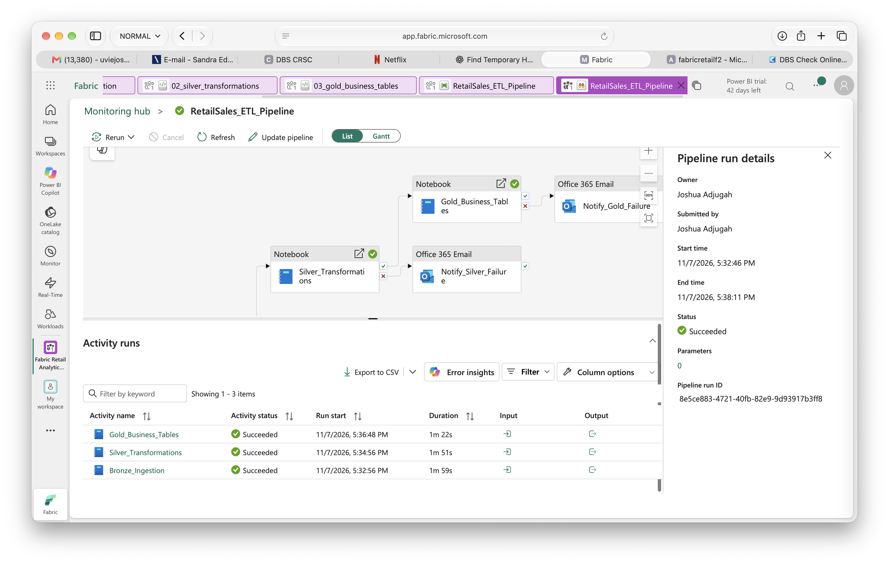

# UK Online Retail Analytics Platform in Microsoft Fabric

An end-to-end data engineering and analytics project built with **Microsoft Fabric**, following a **Bronze → Silver → Gold medallion architecture**, with pipeline orchestration, monitoring, Direct Lake semantic modelling, and Power BI reporting.

The project transforms raw UK online retail transaction data into clean, business-ready datasets for analysing sales, products, customers, cancellations, and geographic performance.

---

## Project Overview

This project demonstrates a complete Microsoft Fabric analytics workflow:

```text
Online Retail.xlsx
        ↓
OneLake Files/raw
        ↓
Bronze Layer
bronze.raw_sales
        ↓
Silver Layer
silver.sales_transactions
        ↓
Gold Layer
├── gold.daily_sales
├── gold.product_performance
├── gold.customer_summary
└── gold.country_sales
        ↓
Direct Lake Semantic Model
        ↓
Power BI Dashboard
```

The solution includes:

- Raw data ingestion
- Data validation and cleaning
- Transaction classification
- Duplicate removal
- Business-ready aggregations
- Automated pipeline orchestration
- Retry and failure handling
- Monitoring
- Scheduled execution
- Direct Lake semantic modelling
- Power BI reporting

---

## Dataset

The project uses the **UCI Online Retail dataset**, containing transaction records from a UK-based online retailer.

Initial dataset profile:

- **541,909 rows**
- **8 source columns**
- Approx. **25,900 invoices**
- Approx. **4,070 stock codes**
- Approx. **4,372 identified customers**
- **38 countries**
- Date range: **1 December 2010 to 9 December 2011**

Initial data quality findings included:

- 135,080 missing Customer IDs
- 1,454 missing descriptions
- 5,268 exact duplicate rows
- 9,288 cancellation transactions
- 10,624 negative quantity rows
- 2,515 zero-price rows
- 2 negative-price rows

---

## Technology Stack

- Microsoft Fabric
- Fabric Lakehouse
- OneLake
- PySpark
- Pandas
- Delta Lake
- Fabric Data Factory
- Fabric Pipelines
- Fabric Monitoring Hub
- Direct Lake
- Power BI
- DAX
- Azure Fabric Capacity

---

# Bronze Layer

The Bronze layer preserves the raw source data with minimal transformation.

The original Excel file is stored in:

```text
Files/raw/Online Retail.xlsx
```

It is ingested into:

```text
bronze.raw_sales
```

Two lineage columns are added:

- `SourceFile`
- `IngestedAt`

No business filtering or analytical transformation is applied at this stage.

### Bronze output

- **541,909 rows**
- 8 original source columns
- 2 lineage columns

---

# Silver Layer

The Silver layer performs the main data-quality and transformation work.

Final table:

```text
silver.sales_transactions
```

Key transformations include:

- Datatype enforcement
- Text trimming
- Customer ID standardisation
- Country-name standardisation
- Transaction classification
- Data-quality flags
- Line amount calculation
- Deterministic transaction hashing
- Exact duplicate removal

---

## Data Quality Decisions

The project avoids automatically deleting unusual records where they may still contain useful business information.

### Missing Customer IDs

Rows with missing Customer IDs are retained because they can still contribute to:

- Overall sales analysis
- Product performance
- Country analysis
- Transaction volumes

They are excluded only from customer-level analysis.

### Cancellations

Invoices beginning with `C` are classified as:

```text
Cancellation
```

They are retained so cancellation behaviour and net revenue can be analysed.

### Negative Quantities

Negative quantities without a cancellation invoice prefix are retained and flagged for review rather than deleted automatically.

### Zero-Price Transactions

Zero-price rows are retained because they may represent:

- Free items
- Stock movements
- Adjustments
- Data-quality issues

### Negative Prices

Rows with description:

```text
Adjust bad debt
```

are classified as accounting adjustments.

Unexpected negative-price rows that are not known accounting adjustments are flagged for review.

### Missing Descriptions

Rows with missing descriptions are retained because the StockCode may still identify the item.

---

## Transaction Classification

Transactions are assigned one of four transaction types using this priority:

```text
1. Cancellation
2. AccountingAdjustment
3. Review
4. Sale
```

This avoids overlapping conditions creating inconsistent classifications.

---

## Data Quality Flags

The Silver table includes:

```text
IsCancellation
HasCustomerID
IsZeroPrice
IsAdjustment
IsNegativePrice
RequiresReview
```

These fields allow downstream analysis to apply business-specific filtering rules.

---

## Transaction ID and Deduplication

A deterministic SHA-256 row-content hash is created using:

- InvoiceNo
- StockCode
- Description
- Quantity
- InvoiceDate
- UnitPrice
- CustomerID
- Country

The result is stored as:

```text
TransactionID
```

Using all eight business fields aligned the deduplication result with the original profiling.

### Deduplication result

```text
Initial rows:        541,909
Duplicates removed:   5,268
Final Silver rows:   536,641
```

Final validation confirmed:

```text
Duplicate TransactionIDs: 0
```

---

## Final Silver Transaction Types

| Transaction Type | Rows |
|---|---:|
| Sale | 525,609 |
| Cancellation | 9,251 |
| Review | 1,778 |
| AccountingAdjustment | 3 |

---

# Gold Layer

The Gold layer contains business-ready datasets designed for reporting and analytics.

---

## 1. Daily Sales

Table:

```text
gold.daily_sales
```

Purpose:

Analyse successful daily sales performance.

Only transactions classified as `Sale` are included.

Metrics include:

- TotalRevenue
- TotalQuantity
- OrderCount
- LineItemCount
- CustomerCount

Example result:

```text
Date: 2010-12-01
Revenue: £58,776.79
Quantity: 26,906
Orders: 136
Line items: 3,037
Customers: 96
```

---

## 2. Product Performance

Table:

```text
gold.product_performance
```

Purpose:

Measure product performance while accounting for cancellations.

Metrics include:

- GrossQuantitySold
- CancelledQuantity
- GrossRevenue
- CancellationValue
- NetQuantity
- NetRevenue
- OrderCount
- CustomerCount

Both `Sale` and `Cancellation` transactions are used.

A canonical product description is selected using the most recent non-null description for each StockCode.

Validation:

```text
Product rows: 3,956
Duplicate StockCodes: 0
```

---

## 3. Customer Summary

Table:

```text
gold.customer_summary
```

Purpose:

Provide one record per identifiable customer.

Rows without CustomerID are excluded because customer-level analysis requires a known customer.

Metrics include:

- FirstPurchaseDate
- LastPurchaseDate
- OrderCount
- TotalQuantity
- GrossRevenue
- CancellationValue
- NetRevenue
- DistinctProductsBought
- AverageOrderValue
- NetAverageOrderValue

Validation confirmed:

```text
Duplicate Customer IDs: 0
```

---

## 4. Country Sales

Table:

```text
gold.country_sales
```

Purpose:

Analyse successful sales performance by country.

Metrics include:

- TotalRevenue
- TotalQuantity
- OrderCount
- CustomerCount
- AverageOrderValue

Country values were standardised upstream in the Silver layer.

Examples:

```text
EIRE → Ireland
RSA → South Africa
```

Final country table:

```text
37 countries
```

---

# Pipeline Orchestration

The full workflow is orchestrated using:

```text
RetailSales_ETL_Pipeline
```

Pipeline sequence:

```text
Bronze_Ingestion
        ↓
Silver_Transformations
        ↓
Gold_Business_Tables
```

Each activity is connected using **On Success** dependencies.

If an upstream activity fails, downstream transformation does not continue.

---

## Retry Strategy

Each notebook activity is configured with:

```text
Retries: 1
Minimum delay: 90 seconds
Maximum delay: 150 seconds
```

This provides resilience against temporary Spark or capacity issues without repeatedly retrying genuine data or code failures.

---

## Failure Notifications

Failure-notification activities were added for each stage:

```text
Notify_Bronze_Failure
Notify_Silver_Failure
Notify_Gold_Failure
```

Notifications include:

- Failed activity
- Pipeline run ID
- Information about downstream processing that did not execute

---

# Monitoring

Microsoft Fabric Monitoring Hub is used to monitor pipeline execution.

A complete end-to-end run successfully executed all three transformation stages.

### Successful run

```text
Bronze Ingestion:         1m 59s
Silver Transformations:  1m 51s
Gold Business Tables:    1m 22s
```

The Monitoring Hub provides:

- Pipeline status
- Activity status
- Duration
- Run identifiers
- Activity outputs
- Troubleshooting information

---

## Fabric Pipeline Monitoring



---

# Scheduling

The pipeline is configured to run daily:

```text
Frequency: Daily
Time: 05:30
Time zone: Europe/London
```

The schedule represents a production-style workflow where transformations run after expected source-data arrival.

Because the project uses a small F2 Fabric capacity, the capacity can be paused outside development and execution periods to reduce cloud cost.

---

# Direct Lake Semantic Model

A Direct Lake semantic model was created:

```text
RetailSalesAnalyticsModel
```

It uses the Gold tables:

```text
country_sales
customer_summary
daily_sales
product_performance
```

The Gold tables intentionally use different analytical grains and are not directly joined together.

---

# DAX Measures

Key measures include:

```DAX
Total Sales Revenue =
SUM(daily_sales[TotalRevenue])
```

```DAX
Total Orders =
SUM(daily_sales[OrderCount])
```

```DAX
Total Customers =
DISTINCTCOUNT(customer_summary[CustomerID])
```

```DAX
Net Revenue =
SUM(product_performance[NetRevenue])
```

```DAX
Gross Revenue =
SUM(product_performance[GrossRevenue])
```

```DAX
Cancellation Value =
ABS(SUM(product_performance[CancellationValue]))
```

```DAX
Average Order Value =
DIVIDE(
    [Total Sales Revenue],
    [Total Orders]
)
```

---

# Power BI Dashboard

The final report is named:

```text
UK Online Retail Sales Analytics
```

Dashboard KPIs include:

- Total Sales Revenue
- Total Orders
- Total Customers
- Net Revenue
- Cancellation Value
- Average Order Value

Visuals include:

- Daily Sales Revenue Trend
- Top 10 Customers by Net Revenue
- Top 10 Products by Net Revenue
- Top 10 Countries by Sales Revenue
- Gross Revenue vs Cancellation Value

---

## Key Results

Final dashboard metrics include approximately:

```text
Total Sales Revenue: £10.63M
Total Orders: 21K
Total Customers: 4K
Net Revenue: £9.73M
Cancellation Value: £893.98K
Average Order Value: £513.05
```

The analysis also shows that the United Kingdom accounts for the majority of transaction activity, while a relatively small number of products and customers contribute a significant share of revenue.

---

## Power BI Dashboard


---

# Key Engineering Decisions

Important design decisions in this project include:

- Preserving missing-customer transactions for non-customer analytics
- Retaining cancellations rather than deleting them
- Separating gross and net revenue analysis
- Flagging uncertain records rather than automatically removing them
- Distinguishing accounting adjustments from standard sales
- Using a deterministic row-content hash for deduplication
- Applying business-specific filters in the Gold layer
- Standardising inconsistent country names upstream
- Keeping analytical tables separated by grain

---

# What I Learned

This project strengthened my understanding of:

- Microsoft Fabric architecture
- Medallion architecture
- Lakehouse design
- PySpark transformation workflows
- Delta tables
- Data-quality management
- Deduplication strategies
- Business-rule design
- Fabric pipeline orchestration
- Retry and failure handling
- Monitoring
- Direct Lake semantic models
- DAX
- Power BI reporting
- Cloud capacity and cost management

One of the main lessons from this project was that data cleaning should not simply mean removing unusual records. Many apparent anomalies can contain meaningful business information, so transformation rules should reflect the purpose of downstream analysis.

---

# Repository Structure

Current repository structure:

```text
uk-online-retail-fabric/
├── powerbi_dashboard.png
├── pipeline_monitoring.png
└── README.md
```

Planned addition:

```text
notebooks/
├── 01_bronze_ingestion.ipynb
├── 02_silver_transformations.ipynb
└── 03_gold_business_tables.ipynb
```

The notebooks will be exported directly from Microsoft Fabric and added to the repository.

---

# Future Improvements

Potential future improvements include:

- Creating reusable date, product, customer, and country dimensions
- Implementing a star schema
- Separating postage and service charges from physical-product rankings
- Adding data-quality monitoring tables
- Adding incremental ingestion
- Parameterising pipelines
- Automating source-file detection
- Adding historical pipeline-performance monitoring
- Expanding Power BI analysis with cancellation rate and customer segmentation

---

## Author

**Uvietobore Adjugah**

MSc Data Science & Artificial Intelligence

Interests: Data Engineering, Data Science, Machine Learning, Analytics, AI
