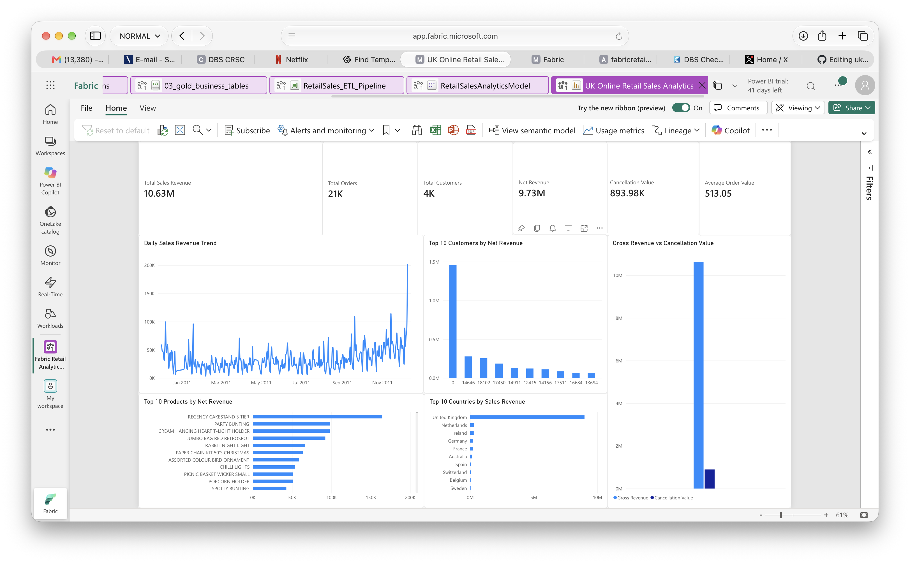

# UK Online Retail Analytics Platform in Microsoft Fabric

An end-to-end data engineering and analytics project built with **Microsoft Fabric**, following a **Bronze → Silver → Gold medallion architecture**.

The project transforms raw UK online retail transaction data into cleaned, validated, business-ready datasets, then delivers insights through an automated Fabric pipeline and Power BI dashboard.

---

## Project Overview

This project was built to demonstrate a complete modern analytics workflow in Microsoft Fabric:

```text
Online Retail.xlsx
        ↓
OneLake / Lakehouse
        ↓
Bronze Layer
bronze.raw_sales
        ↓
Silver Layer
silver.sales_transactions
        ↓
Gold Layer
├── gold.daily_sales
├── gold.product_performance
├── gold.customer_summary
└── gold.country_sales
        ↓
Direct Lake Semantic Model
        ↓
Power BI Dashboard
```

The solution covers:

- Raw data ingestion
- Data profiling and validation
- Data cleaning and standardisation
- Transaction classification
- Duplicate detection and removal
- Business-level aggregations
- Pipeline orchestration
- Retry and failure handling
- Scheduled execution
- Pipeline monitoring
- Direct Lake semantic modelling
- Power BI reporting

---

# Dataset

The project uses the **UCI Online Retail dataset**, containing transaction records from a UK-based online retailer.

### Initial dataset profile

| Metric | Value |
|---|---:|
| Rows | 541,909 |
| Source columns | 8 |
| Approx. invoices | 25,900 |
| Approx. stock codes | 4,070 |
| Identified customers | 4,372 |
| Countries | 38 |
| Date range | Dec 2010 – Dec 2011 |

### Data quality issues identified

- 135,080 missing Customer IDs
- 1,454 missing descriptions
- 5,268 exact duplicate rows
- 9,288 cancellation invoices
- 10,624 negative quantity rows
- 2,515 zero-price rows
- 2 negative-price rows

---

# Technology Stack

- Microsoft Fabric
- Fabric Lakehouse
- OneLake
- PySpark
- Pandas
- Delta Lake
- Fabric Data Factory
- Fabric Pipelines
- Fabric Monitoring Hub
- Direct Lake
- Power BI
- DAX
- Azure Fabric Capacity

---

# Medallion Architecture

## Bronze Layer

The Bronze layer preserves the source data with minimal transformation.

Source file:

```text
Files/raw/Online Retail.xlsx
```

Target table:

```text
bronze.raw_sales
```

Two lineage fields are added:

- `SourceFile`
- `IngestedAt`

No business-level filtering is applied in Bronze.

### Bronze result

```text
Rows: 541,909
Columns: 10
```

---

## Silver Layer

The Silver layer contains the main data-cleaning and validation logic.

Target table:

```text
silver.sales_transactions
```

### Transformations performed

- Enforced appropriate datatypes
- Trimmed text values
- Standardised CustomerID
- Standardised country values
- Created data-quality flags
- Classified transaction types
- Calculated line-level revenue
- Generated deterministic transaction IDs
- Removed exact duplicates

---

## Data Quality Strategy

One of the main design decisions in this project was **not to automatically delete unusual records**.

Instead, records were preserved where they could still provide business value.

### Missing Customer IDs

Rows with missing Customer IDs were retained because they still contribute to:

- total sales
- product analysis
- country analysis
- transaction volumes

They are excluded only from customer-level analysis.

### Cancellations

Invoices beginning with `C` were classified as:

```text
Cancellation
```

They were retained so cancellation behaviour and net revenue could be analysed.

### Negative quantities

Negative quantities without a cancellation invoice prefix were retained and flagged for review.

### Zero-price transactions

Zero-price records were kept because they may represent:

- free items
- stock movements
- operational adjustments
- data-quality issues

### Negative prices

Records with the description:

```text
Adjust bad debt
```

were classified as accounting adjustments.

Unexpected negative prices were flagged for investigation.

### Missing descriptions

Rows with missing descriptions were retained because the StockCode may still identify the item.

---

# Transaction Classification

Transactions were classified using the following priority:

```text
1. Cancellation
2. AccountingAdjustment
3. Review
4. Sale
```

This prevents records that meet multiple conditions from being inconsistently classified.

### Data-quality flags

The Silver table includes:

```text
IsCancellation
HasCustomerID
IsZeroPrice
IsAdjustment
IsNegativePrice
RequiresReview
```

---

# Deduplication

A deterministic SHA-256 row-content hash was generated using:

```text
InvoiceNo
StockCode
Description
Quantity
InvoiceDate
UnitPrice
CustomerID
Country
```

The generated field is:

```text
TransactionID
```

### Deduplication result

```text
Initial rows:        541,909
Duplicates removed:   5,268
Final Silver rows:   536,641
```

Validation confirmed:

```text
Duplicate TransactionIDs: 0
```

### Final transaction types

| Transaction Type | Rows |
|---|---:|
| Sale | 525,609 |
| Cancellation | 9,251 |
| Review | 1,778 |
| AccountingAdjustment | 3 |

---

# Gold Layer

Four business-ready Gold tables were created.

## 1. Daily Sales

```text
gold.daily_sales
```

Used to analyse successful daily sales.

Metrics include:

- TotalRevenue
- TotalQuantity
- OrderCount
- LineItemCount
- CustomerCount

Only `Sale` transactions are included.

---

## 2. Product Performance

```text
gold.product_performance
```

Used to analyse product performance while accounting for cancellations.

Metrics include:

- GrossQuantitySold
- CancelledQuantity
- GrossRevenue
- CancellationValue
- NetQuantity
- NetRevenue
- OrderCount
- CustomerCount

A canonical product description is selected using the most recent non-null description for each StockCode.

### Validation

```text
Product rows: 3,956
Duplicate StockCodes: 0
```

---

## 3. Customer Summary

```text
gold.customer_summary
```

Provides one record per identified customer.

Metrics include:

- FirstPurchaseDate
- LastPurchaseDate
- OrderCount
- TotalQuantity
- GrossRevenue
- CancellationValue
- NetRevenue
- DistinctProductsBought
- AverageOrderValue
- NetAverageOrderValue

Customers without CustomerID are excluded from this table.

---

## 4. Country Sales

```text
gold.country_sales
```

Used to analyse successful sales performance by country.

Metrics include:

- TotalRevenue
- TotalQuantity
- OrderCount
- CustomerCount
- AverageOrderValue

Country names were standardised upstream.

Examples:

```text
EIRE → Ireland
RSA → South Africa
```

Final output:

```text
37 countries
```

---

# Pipeline Orchestration

The end-to-end workflow is orchestrated using:

```text
RetailSales_ETL_Pipeline
```

Pipeline sequence:

```text
Bronze_Ingestion
        ↓
Silver_Transformations
        ↓
Gold_Business_Tables
```

Each stage uses an **On Success** dependency.

If an upstream notebook fails, downstream processing stops.

---

## Retry Strategy

Each notebook activity is configured with:

```text
Retries: 1
Minimum retry delay: 90 seconds
Maximum retry delay: 150 seconds
```

This helps recover from temporary Spark or capacity issues without repeatedly retrying genuine code or data failures.

---

## Failure Notifications

Failure branches were added for each pipeline stage:

```text
Notify_Bronze_Failure
Notify_Silver_Failure
Notify_Gold_Failure
```

Notifications include the failed stage and pipeline run information.

---

# Pipeline Monitoring

Fabric Monitoring Hub was used to validate successful end-to-end execution.

### Successful run

| Activity | Status | Duration |
|---|---|---:|
| Bronze Ingestion | Succeeded | 1m 59s |
| Silver Transformations | Succeeded | 1m 51s |
| Gold Business Tables | Succeeded | 1m 22s |


---

# Scheduling

The pipeline is configured to run daily:

```text
Frequency: Daily
Time: 05:30
Time zone: Europe/London
```

The schedule represents a production-style workflow where processing begins after expected source-data arrival.

The project uses an F2 Fabric capacity, which can be paused outside active development or execution periods to control cloud costs.

---

# Direct Lake Semantic Model

A Direct Lake semantic model was created:

```text
RetailSalesAnalyticsModel
```

It uses the following Gold tables:

```text
country_sales
customer_summary
daily_sales
product_performance
```

The Gold tables are intentionally maintained at different analytical grains.

---

# DAX Measures

Key measures include:

```DAX
Total Sales Revenue =
SUM(daily_sales[TotalRevenue])
```

```DAX
Total Orders =
SUM(daily_sales[OrderCount])
```

```DAX
Total Customers =
DISTINCTCOUNT(customer_summary[CustomerID])
```

```DAX
Net Revenue =
SUM(product_performance[NetRevenue])
```

```DAX
Gross Revenue =
SUM(product_performance[GrossRevenue])
```

```DAX
Cancellation Value =
ABS(SUM(product_performance[CancellationValue]))
```

```DAX
Average Order Value =
DIVIDE(
    [Total Sales Revenue],
    [Total Orders]
)
```

---

# Power BI Dashboard

The final report is:

```text
UK Online Retail Sales Analytics
```

### KPI cards

- Total Sales Revenue
- Total Orders
- Total Customers
- Net Revenue
- Cancellation Value
- Average Order Value

### Visuals

- Daily Sales Revenue Trend
- Top 10 Customers by Net Revenue
- Top 10 Products by Net Revenue
- Top 10 Countries by Sales Revenue
- Gross Revenue vs Cancellation Value

### Final dashboard results

| KPI | Result |
|---|---:|
| Total Sales Revenue | £10.63M |
| Total Orders | 21K |
| Total Customers | 4K |
| Net Revenue | £9.73M |
| Cancellation Value | £893.98K |
| Average Order Value | £513.05 |



---

# Key Insights

The analysis highlighted several important patterns:

- The **United Kingdom dominates overall sales activity**.
- A relatively small number of products contribute a large share of product revenue.
- A relatively small number of customers contribute significantly to total net revenue.
- Cancellation activity has a noticeable impact on gross revenue.
- Daily revenue shows significant variation across the period, with larger spikes toward the end of the dataset.

---

# Key Engineering Decisions

Important decisions made during the project include:

- Retaining transactions with missing Customer IDs for non-customer analysis
- Preserving cancellation records instead of deleting them
- Separating gross and net revenue
- Flagging uncertain records rather than automatically removing them
- Distinguishing accounting adjustments from normal sales
- Using SHA-256 row-content hashing for deterministic deduplication
- Applying business-specific filtering in Gold tables
- Standardising country values in the Silver layer
- Keeping Gold tables separated by analytical grain

---

# Repository Structure

```text
uk-online-retail-fabric/
│
├── notebooks/
│   ├── 01_bronze_ingestion.ipynb
│   ├── 02_silver_transformations.ipynb
│   └── 03_gold_business_tables.ipynb
│
├── screenshots/
│   ├── pipeline_monitoring.png
│   └── powerbi_dashboard.png
│
└── README.md
```

---

# Notebooks

The implementation is available in the `notebooks` folder:

### Bronze ingestion

[`01_bronze_ingestion.ipynb`](notebooks/01_bronze_ingestion.ipynb)

### Silver transformations

[`02_silver_transformations.ipynb`](notebooks/02_silver_transformations.ipynb)

### Gold business tables

[`03_gold_business_tables.ipynb`](notebooks/03_gold_business_tables.ipynb)

---

# What I Learned

This project strengthened my practical understanding of:

- Microsoft Fabric architecture
- Medallion architecture
- Lakehouse design
- PySpark transformations
- Delta tables
- Data-quality management
- Deduplication strategies
- Business-rule design
- Pipeline orchestration
- Retry and failure handling
- Fabric Monitoring Hub
- Direct Lake semantic modelling
- DAX
- Power BI dashboard development
- Cloud capacity and cost management

A key lesson from this project was that **data cleaning does not always mean deleting unusual records**. Many anomalies can contain useful business information, so data-quality decisions should depend on the purpose of the downstream analysis.

---

# Future Improvements

Future enhancements could include:

- Adding reusable date, customer, product, and country dimensions
- Implementing a full star schema
- Separating service charges such as postage from physical product rankings
- Adding incremental ingestion
- Adding automated source-file detection
- Adding data-quality monitoring tables
- Parameterising pipelines
- Adding historical pipeline performance reporting
- Adding customer segmentation
- Adding cancellation-rate analysis

---

## Author

**Uvietobore Joshua Adjugah**

MSc Data Science & Artificial Intelligence

Interested in:

- Data Engineering
- Data Science
- Machine Learning
- Analytics
- Artificial Intelligence
